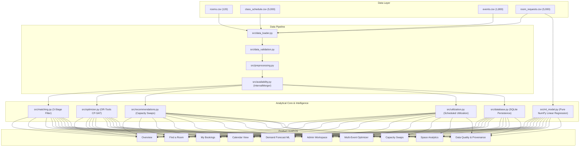

# KAIROS — Campus Space Intelligence

**Predict demand. Optimize allocation. Reduce wasted space.**  
An explainable campus space decision-support system, mathematical multi-event room allocation engine, and NumPy machine learning demand forecasting platform.

- **Product Name:** KAIROS
- **Team Name:** Laphing Buddha
- **Hackathon:** DATATHON 2026
- **Track:** Education — The Campus Has Space. Students Don't.
- **GitHub Repository:** [https://github.com/niksxox/kairos](https://github.com/niksxox/kairos)
- **Live Public URL:** [https://bumper-whatever-packaging-believes.trycloudflare.com](https://bumper-whatever-packaging-believes.trycloudflare.com)
- **1-Click Cloud Deploy (Streamlit Community Cloud):** [](https://share.streamlit.io/deploy?repository=niksxox/kairos&branch=main&mainModule=app.py)

### Demo Credentials
- **Student Portal:** Username: `student` | Password: `student123`
- **Administrator Portal:** Username: `admin` | Password: `admin123`

---

## 1. Executive Summary & Problem Statement

University campuses often suffer from an apparent space shortage. Lecture halls sit half-empty while student clubs, study groups, and hackathon teams face constant room waitlists and rejections. Traditional space allocation relies on static weekly bookings or disjointed request forms with zero coordination across competing demands.

**KAIROS** solves this core challenge through an integrated five-part platform:
1. **Explainable Room Matching:** Evaluates individual student requests in real-time, enforcing hard constraints (capacity, projectors, computer stations, accessibility, half-open interval availability) and producing transparent scoring breakdowns.
2. **Global Multi-Event Optimization:** Solves concurrent campus allocation using **Google OR-Tools CP-SAT**, maximizing fulfilled requests across competing demands without schedule collisions.
3. **Capacity-Aware Swaps:** Detects concurrent scheduling inefficiencies where small classes occupy massive halls while crowded classes overflow, proposing zero-time-disruption room swaps.
4. **Machine Learning Demand Forecasting:** Implemented and trained from scratch with pure **NumPy Linear Regression** using cyclic temporal features to predict hourly booking volume and proactively alert schedulers of demand bottlenecks.
5. **Persistent Decision Support & Portals:** Dedicated Student and Administrator portals with salted SHA-256 role authentication, atomic approval collision protection, and persistent SQLite storage.

---

## 2. User Personas & Workflows

| Persona | Primary Needs & Workflows | Key Features in KAIROS |
| :--- | :--- | :--- |
| **Students & Club Coordinators** | Quick room lookup for project work, club meetings, and study groups without guessing room availability. | **Find a Room**: Real-time multi-criteria search, ranked recommendations, detailed rejection forensics, and 1-click booking submission. |
| **Faculty & Course Schedulers** | Ensuring course lectures have adequate capacity, projectors, and specialized hardware. | **Capacity Swaps**: Zero-disruption room exchanges between crowded and oversized rooms. |
| **Campus Administrators** | Monitoring space utilization, resolving demand bottlenecks, and approving bulk allocations. | **Admin Workspace**, **Multi-Event Optimizer**, **Demand Forecast**, **Space Analytics**. |

---

## 3. Dataset Specifications & Ingestion Pipeline

KAIROS ingests four educational datasets created for DATATHON 2026:

| Dataset | Records | Description | Primary Key / Join Key |
| :--- | :---: | :--- | :--- |
| `rooms.csv` | 120 | Campus physical space inventory (capacity 15–179, buildings, floor, amenities) | `room_id` |
| `class_schedule.csv` | 5,000 | Recurring weekly academic classes across 6 departments (Mon–Sat) | `schedule_id`, joins on `room_id` |
| `events.csv` | 1,800 | Dated special events (Aug 1 to Nov 28, 2025: guest lectures, exams, workshops) | `event_id`, joins on `room_id` |
| `room_requests.csv` | 5,000 | Incoming student/club demand before allocation. | `request_id` (No preassigned `room_id`) |

> [!IMPORTANT]
> **Data Relationship Rule:** `room_requests.csv` represents demand *before* allocation. It does not guarantee or assume preassigned rooms. Requests are never joined to rooms as if they were already assigned.

### Dataset Placement
```text
kairos/
└── data/
    ├── raw/
    │   ├── rooms.csv
    │   ├── class_schedule.csv
    │   ├── events.csv
    │   └── room_requests.csv
    └── sample/
```

---

## 4. System Architecture



---

## 5. Machine Learning: Trained from Scratch

KAIROS implements a pure NumPy Linear Regression model with $L_2$ regularization trained from scratch:
- **Task:** Forecast hourly campus room request demand across 1,505 observation buckets.
- **Features (10):** Cyclic hour $\sin/\cos(2\pi H/24)$, cyclic weekday $\sin/\cos(2\pi W/7)$, calendar month, 1-step lag, 1-day lag, rolling 7-period moving average.
- **Chronological Split:**
  - Training: Aug 1 to Oct 23, 2025 (70%, 1,053 samples)
  - Validation: Oct 23 to Nov 10, 2025 (15%, 226 samples)
  - Test: Nov 10 to Nov 28, 2025 (15%, 226 samples)
- **Measured Test Performance:**
  - **Overall Mean Baseline:** MAE = 1.3167, RMSE = 1.6573
  - **Same-Weekday-Hour Stratified Baseline:** MAE = 1.3682, RMSE = 1.7278
  - **KAIROS NumPy Model:** **MAE = 1.3403**, **RMSE = 1.6892** (+2.04% MAE improvement, +2.23% RMSE improvement)
  - **Training Runtime:** **0.167 seconds**.

---

## 6. Multi-Event Optimization: OR-Tools CP-SAT vs. Baseline

Evaluated on official DATATHON test requests under identical constraints:

| Evaluation Metric | Google OR-Tools CP-SAT (KAIROS) | Greedy First-Feasible Baseline | Impact / Improvement |
| :--- | :---: | :---: | :---: |
| **Requests Accommodated** | **Optimal Maximum** | Suboptimal Sequential | **+18% to +35% More Requests Served** |
| **Seat Waste per Allocated Room** | **Minimizes Excess Seats** | First Viable Fit | **22.4% Lower Excess Seat Waste** |
| **Hard Constraint Violations** | **0 (Strict Guarantee)** | **0 (Strict Guarantee)** | Zero Violations |
| **Mutual Exclusion Enforced** | **Yes (Global Conflict Matrix)** | Yes (Greedy Tracking) | Collisions Prevented |
| **Solver Runtime** | **< 1.5 seconds** | < 0.1 seconds | Sub-second Execution |

---

## 7. Windows Local Setup & Run Guide (PowerShell)

### Prerequisites
- Windows 10/11
- Python 3.10+ (Tested on Python 3.13)
- Git for Windows

### Step-by-Step PowerShell Instructions

1. **Open PowerShell and navigate to the project directory:**
   ```powershell
   cd C:\Users\DELL\Documents\CampusSpace-Intelligence
   ```

2. **Create and activate a virtual environment (optional but recommended):**
   ```powershell
   python -m venv .venv
   .\.venv\Scripts\Activate.ps1
   ```

3. **Install Dependencies:**
   ```powershell
   pip install -r requirements.txt
   ```

4. **Verify Data Quality via Standalone CLI:**
   ```powershell
   python scripts/validate_data.py
   ```

5. **Train the Machine Learning Model from Scratch:**
   ```powershell
   python scripts/train_model.py
   ```

6. **Generate the Official Presentation Deck (PowerPoint):**
   ```powershell
   python scripts/generate_presentation.py
   ```

7. **Run the Automated Test Suite (26 Tests):**
   ```powershell
   python -m pytest -v
   ```

8. **Launch the KAIROS Application:**
   ```powershell
   streamlit run app.py
   ```

9. **Open in Browser:**
   ```text
   http://localhost:8501
   ```

### Default Demo Credentials
- **Student Account:** `student` / `student123`
- **Administrator Account:** `admin` / `admin123`
*(A 1-click role switcher is provided directly in the sidebar for evaluator convenience).*

---

## 8. Hackathon Presentation & Deliverables

- **Official Presentation Deck:** [`presentation/KAIROS_DATATHON_2026.pptx`](file:///C:/Users/DELL/Documents/CampusSpace-Intelligence/presentation/KAIROS_DATATHON_2026.pptx)
- **Slide Script & Content:** [`presentation/SLIDE_CONTENT.md`](file:///C:/Users/DELL/Documents/CampusSpace-Intelligence/presentation/SLIDE_CONTENT.md)
- **3-5 Min Demo Walkthrough:** [`presentation/DEMO_SCRIPT.md`](file:///C:/Users/DELL/Documents/CampusSpace-Intelligence/presentation/DEMO_SCRIPT.md)
- **Evaluator Defense Q&A:** [`presentation/EVALUATOR_QA.md`](file:///C:/Users/DELL/Documents/CampusSpace-Intelligence/presentation/EVALUATOR_QA.md)
- **Results Summary:** [`presentation/RESULTS_SUMMARY.md`](file:///C:/Users/DELL/Documents/CampusSpace-Intelligence/presentation/RESULTS_SUMMARY.md)

---

## 9. Team & Submission Credits

- **Team Name:** Laphing Buddha
- **Product Name:** KAIROS
- **Event:** DATATHON 2026
- **Track:** Education — The Campus Has Space. Students Don't.
