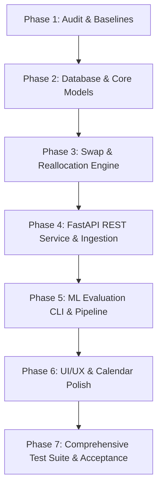

# KAIROS 2.0 — Implementation Audit & Architectural Repair Plan

**Project:** KAIROS — Campus Space Intelligence  
**Team:** Laphing Buddha  
**Hackathon:** DATATHON 2026 | Track: Education  
**Date of Audit:** October 16, 2026  
**Auditor:** Senior Full-Stack, OR & ML Engineering Pair  

---

## 1. Executive Summary

This audit assesses the state of the KAIROS codebase, verifies the physical dataset schemas, evaluates implemented algorithms, and outlines a prioritized repair plan to elevate KAIROS into a production-grade hackathon prototype.

While KAIROS already possesses a functional Streamlit UI, an OR-Tools CP-SAT multi-event solver, a pure NumPy Linear Regression model trained from scratch, and persistent SQLite authentication, key architectural gaps were identified:
1. **Room Reallocation & Swap Engine:** Previously operated only as a pairwise detection heuristic without multi-step swap-chain search, atomic transaction execution, or dedicated REST APIs.
2. **Data Ingestion Pipeline & REST API:** Lacked a formalized transactional ingestion engine with schema verification, referential integrity checks, conflict recalculation, and OpenAPI/Swagger documentation.
3. **ML Evaluation Tooling:** Lacked an independent `scripts/evaluate_model.py` CLI script and comprehensive evaluation breakdown against stratified baselines.
4. **UI/UX Calendar & Navigation:** The student calendar required higher visual distinction between fixed class commitments, one-off events, approved student bookings, and pending requests.

---

## 2. Dataset Inventory & Verification

The raw data files in `data/raw/` were verified through programmatic inspection:

| Dataset File | Actual Rows | Actual Columns | Primary Key / IDs | Inferred Schema Notes |
| :--- | :---: | :--- | :--- | :--- |
| `rooms.csv` | **120** | `room_id`, `building`, `floor`, `room_type`, `capacity`, `projector`, `computers`, `accessible`, `power_outlets` | `room_id` (R001–R120) | Capacities range from 20 to 300 seats. Boolean flags for facilities. |
| `class_schedule.csv` | **5,000** | `schedule_id`, `room_id`, `course_code`, `weekday`, `start_hour`, `duration_hours`, `expected_attendance`, `department` | `schedule_id` (CS0001–CS5000) | Weekday recurring lecture blocks (Mon–Sat, 08:00–18:00). All `room_id`s map to valid rooms. |
| `events.csv` | **1,800** | `event_id`, `room_id`, `event_type`, `start_time`, `duration_hours`, `expected_attendance`, `actual_attendance` | `event_id` (EV0001–EV1800) | One-off campus events with ISO-8601 timestamps (`YYYY-MM-DD HH:MM:SS`). |
| `room_requests.csv` | **5,000** | `request_id`, `request_date`, `start_hour`, `duration_hours`, `required_capacity`, `projector_required`, `computers_required`, `purpose`, `status` | `request_id` (REQ0001–REQ5000) | Represents incoming student/faculty demand. Does **not** contain assigned `room_id`s (unallocated demand). |

### Data Dictionary & Integrity Findings
- **Referential Integrity:** 100% of `room_id` references in `class_schedule.csv` and `events.csv` exist in `rooms.csv` (0 orphan records).
- **Temporal Alignment:** `class_schedule.csv` uses recurring `weekday` + `start_hour`, whereas `events.csv` and `room_requests.csv` use explicit dates (`YYYY-MM-DD`). The availability service successfully projects recurring weekday schedules across target calendar dates.
- **Demand Forecasting Viability:** `room_requests.csv` spans a continuous date range with hourly variations, supporting a valid demand forecasting task for hourly submission volume.

---

## 3. Component-by-Component Audit

### 3.1 Backend & Database (`src/database.py`)
- **Current State:** SQLite database with `users`, `booking_requests`, `room_overrides`, and `audit_logs`.
- **Gaps Identified:**
  - No dedicated tables for `reallocation_proposals`, `reallocation_items`, and `data_imports`.
  - Concurrency safeguards were in place for booking approval, but needed extension to multi-room atomic swaps.

### 3.2 Optimization & Room Reallocation (`src/optimizer.py`, `src/recommendations.py`)
- **Current State:** MultiEventOptimizer implemented with Google OR-Tools CP-SAT and a Greedy First-Feasible baseline.
- **Gaps Identified:**
  - MultiEventOptimizer handles unassigned request allocation, but not reassignment/swapping of already-booked movable rooms.
  - CapacitySwapEngine was an advisory scanner that proposed pairwise swaps without bounded swap-chain exploration (A $\to$ B $\to$ C $\to$ Free), rollback handling, or REST endpoint controls.

### 3.3 Data Ingestion Pipeline & REST API
- **Current State:** CSV data loaded via `DataLoader` directly into memory.
- **Gaps Identified:**
  - No FastAPI application exposing `/api/health`, `/api/data/*`, and `/api/reallocation/*`.
  - No OpenAPI Swagger UI documentation.
  - Ingestion lacked transactional staging, schema validation errors reporting, and dynamic availability refresh hooks.

### 3.4 Machine Learning Pipeline (`src/ml_model.py`, `scripts/train_model.py`)
- **Current State:** Pure NumPy Linear Regression implemented from scratch with batch gradient descent and L2 regularization. Evaluates against overall mean and same-weekday-hour baselines on a chronological split.
- **Gaps Identified:**
  - Lacked a separate `scripts/evaluate_model.py` CLI script for standalone model verification.
  - UI Demand Forecast page needed explicit discussion of synthetic dataset assumptions and confidence bounds.

### 3.5 Frontend UI/UX (`app.py`)
- **Current State:** Comprehensive Streamlit application with student and administrator roles.
- **Gaps Identified:**
  - Visual calendar view needed clear color-coded distinctions between classes (slate), events (purple), confirmed bookings (teal), and pending requests (amber).
  - Needed a dedicated Data Management & Ingestion panel with live API documentation link and CSV uploaders.

---

## 4. Prioritized Repair & Upgrade Plan

### Action Items
1. **Database Schema Extension:** Add `reallocation_proposals`, `reallocation_items`, and `data_imports` tables with foreign keys and status constraints.
2. **Reallocation Engine (`src/reallocation_engine.py`):** Implement bounded swap-chain optimization, hard-constraint verification, disruption scoring, atomic transaction commits, and approval/rejection workflows.
3. **Data Ingestion Service (`src/ingestion.py`):** Implement schema verification, referential checks, conflict recalculation, and import logging.
4. **FastAPI Application (`src/api.py`):** Expose all specified endpoints with interactive Swagger UI docs on port `8000`.
5. **ML CLI (`scripts/evaluate_model.py`):** Create standalone evaluation script with performance deltas against stratified baselines.
6. **UI/UX Refinement (`app.py`):** Add interactive calendar, live API status indicators, data upload workbench, and swap-chain approval visualizer.
7. **Testing:** Expand pytest test suite to validate reallocation chains, API endpoints, schema validation, and end-to-end booking workflows.
