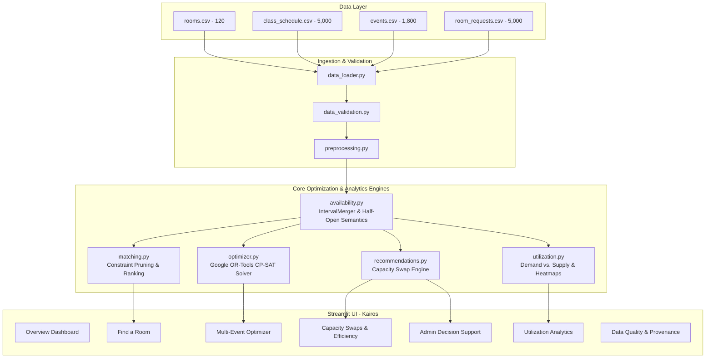

# Kairos — System Architecture & Mathematical Specification

**Project:** Kairos  
**Team:** Laphing Buddha  
**Hackathon:** DATATHON 2026  
**Track:** Education — The Campus Has Space. Students Don't.

---

## 1. System Architecture Overview

---

## 2. Dataset Relational Structure

- **rooms.csv** (120 records): Master space catalog (capacity, building, floor, room_type, projector, computers, accessible, power_outlets).
- **class_schedule.csv** (5,000 records): Recurring weekly classes mapped to rooms via `room_id`.
- **events.csv** (1,800 records): Calendar-dated ad-hoc events mapped to rooms via `room_id`.
- **room_requests.csv** (5,000 records): Incoming demand before allocation. **Does NOT guarantee `room_id`** because requests represent unmet demand.

---

## 3. Mathematical Optimization Formulation

### Decision Variables
For each incoming request $i \in I$ and candidate room $j \in J$:
$$x_{i, j} \in \{0, 1\}$$
where $x_{i, j} = 1$ if request $i$ is assigned to room $j$, and $0$ otherwise.

### Hard Constraints

1. **At Most One Room Per Request:**
   $$\sum_{j \in J_i} x_{i, j} \le 1 \quad \forall i \in I$$

2. **No Overlapping Proposed Allocations:**
   For any pair of requests $i_1, i_2$ on the same date with overlapping half-open intervals $[s_1, e_1)$ and $[s_2, e_2)$:
   $$x_{i_1, j} + x_{i_2, j} \le 1 \quad \forall j \in (J_{i_1} \cap J_{i_2})$$

3. **Candidate Feasibility Pruning:**
   Candidate set $J_i$ contains room $j$ if and only if:
   - $\text{capacity}_j \ge \text{required\_capacity}_i$
   - $\text{projector}_j \ge \text{projector\_required}_i$
   - $\text{computers}_j \ge \text{computers\_required}_i$
   - $\text{accessible}_j \ge \text{accessible\_required}_i$
   - Room $j$ has no conflict with existing merged class and event intervals during $[s_i, e_i)$.

### Multi-Tier Objective Hierarchy

$$\max \sum_{i \in I} \sum_{j \in J_i} \Big( M \cdot x_{i, j} - (\text{capacity}_j - \text{required\_capacity}_i) \cdot x_{i, j} \Big)$$

where $M = 100,000$ guarantees lexicographic dominance: accommodating an additional student request strictly dominates minimizing excess seat waste.
